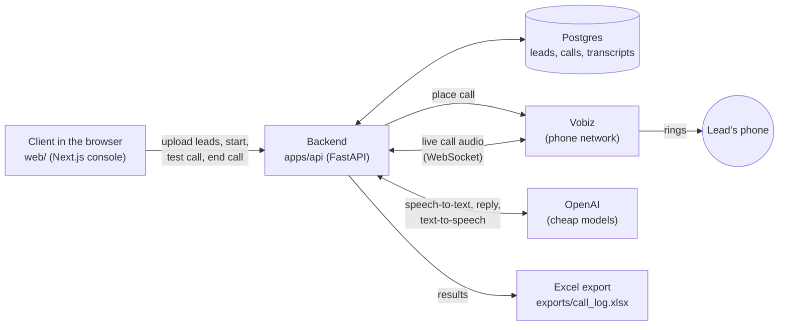
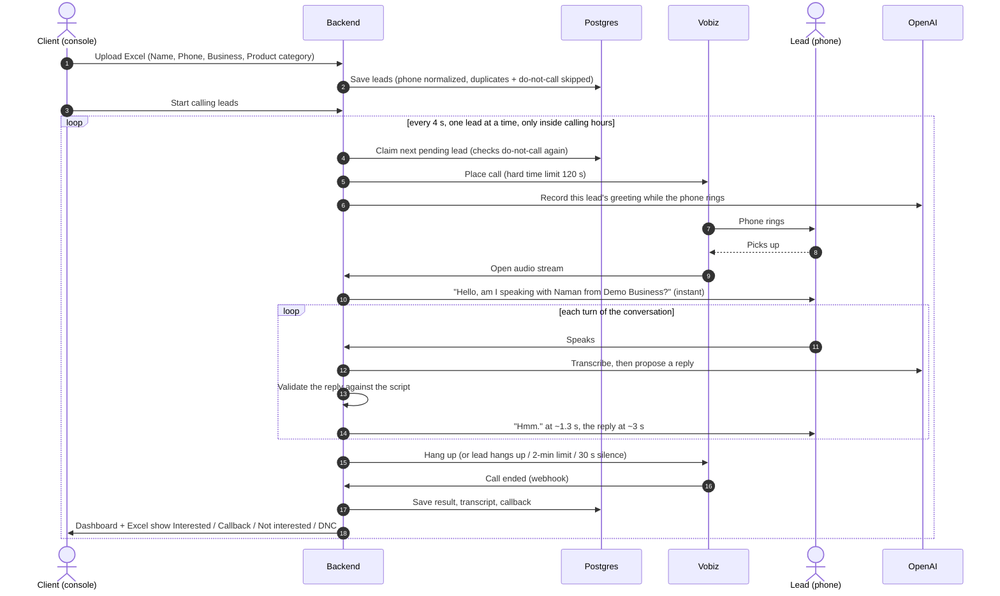
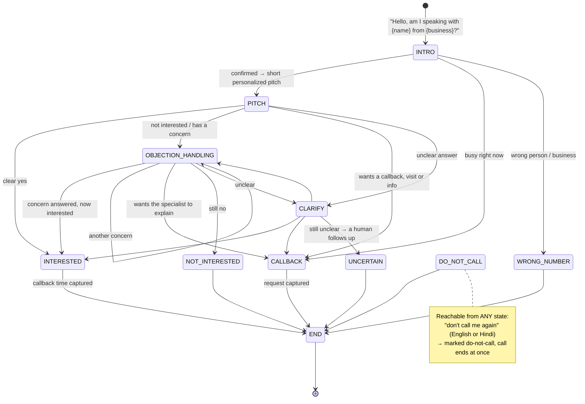
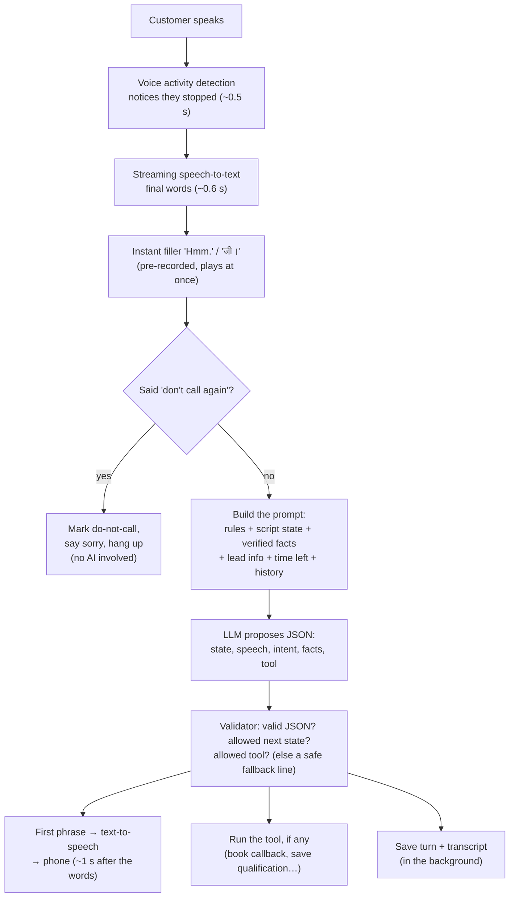

# How this project works

A plain-language tour of the AI sales caller: what happens from uploading a lead
sheet to a qualified lead landing in Excel. For the rules every change must follow
see `CLAUDE.md`; for what's real vs. placeholder see `STATUS.md`.

**In one sentence:** you upload a list of leads, the AI agent phones them one by one,
has a short natural conversation (English, Hindi or Hinglish), and marks each lead
*Interested*, *Callback requested*, *Not interested* or *Do not call* — the interested
ones are handed to the human sales team.

---

## 1. The big picture



| Piece | What it does | Where |
|---|---|---|
| Console (website) | Login, upload Excel, add a lead, test call, watch the live call, end call, history, export | `web/` |
| Console API | Everything the website calls; also the auto-dialer | `apps/api/routers/console.py` |
| Telephony | Places the call and streams audio (Vobiz today; FreJun/Exotel/Twilio adapters exist) | `telephony/` |
| Voice session | The live call: hears the customer, detects when they stop talking, plays the agent's voice | `voice/session/session.py` |
| Brain | Decides what to say next, within the script's rules | `orchestrator/` |
| Speech | Speech-to-text and text-to-speech (OpenAI; local backup models too) | `speech/` |
| LLM | Writes the agent's reply (gpt-4.1-mini) | `llm/` |
| Tools | The only actions the agent can take: book a callback, mark do-not-call, save qualification… | `tools/` |
| Business config | The script, the wording, the facts it may say, the qualification bar | `config/` |
| Database | Leads, call attempts, conversations, transcripts, callbacks | `database/` |

---

## 2. Life of a lead, from Excel to result



**Test call** (console → *Test call*) is the same thing for one number, right now,
at any hour, without adding it to the lead list.

---

## 3. The conversation flow (the client's script)

Defined in `config/scripts/seller-flow.yaml` — change the flow there, not in Python.



What each step means in practice:

- **Greeting + business confirmation** — a fixed opening line, played instantly (no AI wait).
- **Pitch** — one or two sentences: we help businesses like yours (mentions their product
  category if the sheet has one) sell on Amazon / online; would you be interested?
- **Intent detection** — "hmm", "okay" alone is *listening*, not a yes: the agent asks once more.
- **Interested** → "our specialist will call you — what day and time suits you?" → booked → goodbye.
- **Not interested** → asks the reason once → answers that specific concern
  (pricing, returns, payments, operations, trust, timing) → asks again → respects a second no.
- **Questions** → answered **only** from verified facts in `config/prompts/seller-flow.yaml`
  (`knowledge`). If a fact isn't filled in there, the agent says the specialist will explain
  and offers the callback — it never makes up prices or promises.
- **Callback / visit / "send details on WhatsApp"** → captured and saved for the team.
- **Do not call** → always wins, from anywhere in the call.

---

## 4. One conversation turn, up close

What happens between the customer finishing a sentence and the agent answering:



Where the ~3 s goes (measured): noticing they stopped 0.6 s · speech-to-text 0.7 s ·
the LLM's first words 1.0–1.4 s · first voice audio 0.8 s. The pre-recorded filler
covers the wait. Faster/cheaper models were tested and rejected: `gpt-4.1-nano` made up
facts and booked wrong callback times.

The call never stops listening while the agent thinks or talks: each finished sentence
from the customer joins a queue and is answered in order.

**Talking over the agent:**
- Long speech (over 0.6 s) cuts the agent off, and it answers.
- A short "haan / okay / hmm" is ignored; the agent keeps talking.
- A short real answer ("no", a question) is answered right after the agent finishes.

The agent's voice goes to Vobiz at the TTS's own 24 kHz, untouched
(`VOBIZ_OUTBOUND_SAMPLE_RATE`). Converting it to 8 kHz ourselves made it harsh and
hard to follow.

Rule of the house: **the AI proposes, the app decides.** The model never directly
changes a lead's result, never skips the script, never runs a tool that state doesn't
allow, and "qualified" is computed from the facts it reports (`qualification/`), not
taken from its word.

---

## 5. How a call can end — and why it never runs away

| Who / what | When | Result |
|---|---|---|
| The agent | Conversation finished (booked, declined, wrong number) | Says goodbye, hangs up |
| The lead | Hangs up | Vobiz reports it; call closed |
| **End call** button | Any time, from the console | Hung up through Vobiz immediately |
| Time limit | **2 minutes** (`DEFAULT_MAX_CALL_DURATION_SECONDS=120`) | At 1:50 the agent says a short goodbye and hangs up; Vobiz also cuts at 2:00 on its side |
| Silence | 30 s with nobody talking (`SILENCE_HANGUP_SECONDS`) | Agent hangs up (covers a lead who hung up without Vobiz noticing) |
| Safety check | Every ~20 s the console asks Vobiz whether "live" calls really are | Calls Vobiz says are over are closed out |
| No answer / busy | Phone not picked up | Recorded as *No answer* / *Busy* |

---

## 6. Where results go

Each finished call gets one label, decided by the app from what actually happened in the
call (the states it reached, a booked callback, a DNC request):

| Label | Meaning |
|---|---|
| **Interested** | Reached INTERESTED — wants the specialist's call (time booked when given) |
| **Callback requested** | Asked to be called back / sent info, or a human should follow up |
| **Not interested** | Declined, even after their concern was answered |
| **Do not call** | Asked never to be called — that number is never dialled again |
| Unclear / No answer / Busy / Call failed | Self-explanatory |

You see them on the **Dashboard**, the **Leads** list, **Call history** (with the full
transcript of every call), and the **Excel export** (sheets: *All leads*, *Calls*,
*Interested leads*).

---

## 7. Running it locally

```powershell
# 1. Backend (Postgres must be running on port 55434)
.\.venv\Scripts\python.exe -m uvicorn apps.api.main:app --port 8000

# 2. Public URL so Vobiz can reach the laptop (writes PUBLIC_BASE_URL into .env;
#    restart the backend after it)
powershell -ExecutionPolicy Bypass -File scripts\start_tunnel.ps1

# 3. The console
cd web; npm run dev        # → http://localhost:3100
```

Log in with the console account from `.env` (`CONSOLE_USERNAME` / `CONSOLE_PASSWORD`).
**Try the voice demo** (link on the login page and sidebar) talks to the same agent
through your browser microphone — no phone call, no telephony cost.

---

## 8. What to change, and where

| You want to… | Edit |
|---|---|
| Change what the agent says, or the flow | `config/scripts/seller-flow.yaml` |
| Give the agent real answers (pricing, returns, payments…) | `config/prompts/seller-flow.yaml` → `knowledge` |
| Change general behavior (tone, name usage, language) | `config/prompts/system_prompt.yaml` |
| Change what counts as "qualified" | `config/qualification/seller-flow.yaml` |
| Change call length, silence timeout, models, login | `.env` (see `.env.example` for every option) |
| Calling hours | Console → Settings |

If a business change needs a `.py` edit, that's a bug — business logic lives in `config/`.

---

## 9. Cost of a call (rough)

| Part | ~Cost for a 2-minute call |
|---|---|
| Vobiz phone minutes | under ₹1 |
| OpenAI speech-to-text (streaming) | ~$0.03 |
| OpenAI reply model (gpt-4.1-mini) + voice | ~$0.02 |

Expensive OpenAI models are blocked in code (`config/settings.py`) unless explicitly
allowed, so a typo can't burn the budget.
